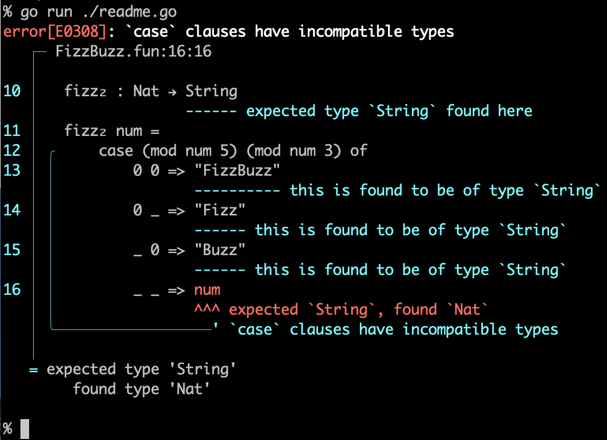

# `srcspan` -- A Go port of Rust's Codespan

Beautiful diagnostic reporting for text-based programming languages
and complex configuration files.



Error messages from Go-related tools are as simple as those from
classic Unix tools.

While this may not be a problem for experienced software engineers, it
can sometimes make it difficult for many others to understand the
nature of the error.

This is a Go module that features functionality similar to Rust's
[codespan](https://github.com/brendanzab/codespan).  Actually,
`srcspan` is a literal one-to-one port of `codespan` and tries to have
a similar interface as `codespan`.


## Status

The API is not stable yet. Until it is, the module path is
intentionally set to `srcspan` (instead of
`github.com/nobuyuki/srcspan`), so `go get` does not work and the
module is not published on pkg.go.dev.

To try it, clone the repository and point your module at it with a
`replace` directive:

```sh
git clone https://github.com/nobuyuki/srcspan ../srcspan
go mod edit -require=srcspan@v0.0.0 -replace=srcspan=../srcspan
```

Import the packages as `srcspan/diagnostic`, `srcspan/files`,
`srcspan/term`, and so on. Expect breaking changes; the module path
will change to `github.com/nobuyuki/srcspan` once the API is stable.


## Example
```go
package main

import (
	"os"

	"srcspan/diagnostic"
	"srcspan/files"
	"srcspan/term"
)

var content = []byte(`module FizzBuzz where

fizz₁ : Nat → String
fizz₁ num = case (mod num 5) (mod num 3) of
    0 0 => "FizzBuzz"
    0 _ => "Fizz"
    _ 0 => "Buzz"
    _ _ => num

fizz₂ : Nat → String
fizz₂ num =
    case (mod num 5) (mod num 3) of
        0 0 => "FizzBuzz"
        0 _ => "Fizz"
        _ 0 => "Buzz"
        _ _ => num
`)

func main() {
	fs := files.NewSimpleFiles()
	file_id := fs.Add("FizzBuzz.fun", string(content))

	// We normally recommend creating a custom diagnostic data type for your
	// application, and then converting that to `codespan-reporting`'s diagnostic
	// type, but for the sake of this example we construct it directly.

	diagnostic := diagnostic.NewError().WithMessage("`case` clauses have incompatible types").WithCode("E0308").WithLabels([]diagnostic.Label{
		diagnostic.NewPrimary(file_id, files.NewRange(328, 331)).WithMessage("expected `String`, found `Nat`"),
		diagnostic.NewSecondary(file_id, files.NewRange(211, 331)).WithMessage("`case` clauses have incompatible types"),
		diagnostic.NewSecondary(file_id, files.NewRange(258, 268)).WithMessage("this is found to be of type `String`"),
		diagnostic.NewSecondary(file_id, files.NewRange(284, 290)).WithMessage("this is found to be of type `String`"),
		diagnostic.NewSecondary(file_id, files.NewRange(306, 312)).WithMessage("this is found to be of type `String`"),
		diagnostic.NewSecondary(file_id, files.NewRange(186, 192)).WithMessage("expected type `String` found here"),
	}).WithNotes([]string{
		`expected type 'String'
   found type 'Nat'`})

	writer := term.NewStylesWriter(os.Stdout, term.DefaultColor())
	config := term.DefaultConfig()

	err := term.EmitToWriteStyle(writer, &config, &fs, diagnostic)
	if err != nil {
		os.Exit(1)
	}
	os.Exit(0)
}
```
([./examples/example/example.go](./examples/example/example.go))


## Running the CLI example

To get an idea of what the colored CLI output looks like, clone the
repository and run the following shell command:

```sh
go run ./examples/codespan/term/term.go

```
More examples of using `srcspan` can be found in the `examples` directory.


## Packages

The packages follow the structure of the original Rust crates:

- `srcspan/files`, `srcspan/diagnostic` and
  `srcspan/term` correspond to `codespan-reporting`. The
  `files.Files` interface corresponds to the `Files` trait, and
  `files.SimpleFile` / `files.SimpleFiles` to its simple implementations.
- `srcspan` corresponds to `codespan`: `Span` and a `Files`
  database that also implements `files.Files`.
- `srcspan/lsp` corresponds to `codespan-lsp`: it
  translates byte indices and spans into Language Server Protocol positions
  and ranges.

As in Rust, the `codespan-reporting` side does not depend on the
`codespan` side.

See [Porting from Rust](./docs/porting-from-rust.md) for how the Rust API
maps to the Go API.


## License

`srcspan` is a Go port of [codespan](https://github.com/brendanzab/codespan)
(`codespan` and `codespan-reporting`) by Brendan Zabarauskas and its
contributors, which is licensed under the Apache License, Version 2.0.

`srcspan` is also licensed under the [Apache License, Version 2.0](./LICENSE).


(EOF)
